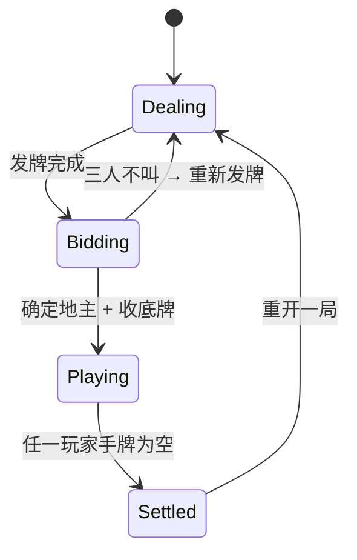

# 05 · 系统架构

> 本文档描述运行时架构、数据流、状态机与核心数据模型。
> 配合 [03-project-structure.md](./03-project-structure.md)（静态结构）与 [04-game-rules.md](./04-game-rules.md)（规则）阅读。

## 1. 分层架构总览

```
┌─────────────────────────────────────────────────────────┐
│  UI 层 (lib/ui)   —— Flutter Widget，仅渲染与输入        │
│      ConsumerWidget / ConsumerStatefulWidget             │
└───────────────▲─────────────────────────┬───────────────┘
                │ watch(states)           │ 用户动作
┌───────────────┴─────────────────────────▼───────────────┐
│  状态层 (lib/state) —— Riverpod Notifier                 │
│      GameSessionNotifier（驱动一局生命周期）             │
└───────────────▲─────────────────────────┬───────────────┘
                │ apply(state,action)     │ 谁出牌？
┌───────────────┴──────────┬──────────────▼───────────────┐
│  规则核心 (lib/core)      │  AI 层 (lib/ai)               │
│  纯函数、不可变状态       │  chooseAction(state)->Action  │
│  game_engine / detector  │  heuristic / pimc / douzero   │
└──────────────────────────┴───────────────────────────────┘
                ▲
                │ （Phase 3：状态/动作也由服务端权威下发）
┌───────────────┴──────────────────────────────────────────┐
│  网络层 (lib/net) —— WebSocket，与服务端同步             │
└──────────────────────────────────────────────────────────┘
```

**关键约束**：
- `core` 是纯领域逻辑，**所有状态转移 = 函数式 `apply(state, action) -> newState`**。
- UI 永远不直接调用 `core` 修改状态；必须经 `state/` 层。
- AI 与人类玩家对状态层「**地位平等**」：都产出 `Action`，由状态层统一调度。

## 2. 核心抽象：状态 + 动作 + 引擎

采用**事件溯源风格 (event-sourced)** 的纯函数引擎，优势：
- 易测试（输入输出确定）。
- 易回放/悔棋/重连（动作序列可重放）。
- 单机与联网共用同一套规则。

### 2.1 游戏状态 `GameState`（不可变）

```dart
@freezed
class GameState with _$GameState {
  const factory GameState({
    required GamePhase phase,          // dealing/bidding/playing/settled
    required List<PlayerState> players,// 3 个玩家，按座位索引
    required int currentPlayer,        // 当前轮到谁（座位 0/1/2）
    required int? landlordSeat,        // 地主座位（叫地主后确定）
    required List<Card> bottomCards,   // 3 张底牌
    required PlayFrame? lastValidPlay, // 当前回合最后一手有效牌
    required int lastValidPlayer,      // 谁打的
    required int passCount,            // 连续 pass 次数（=2 时自由出）
    required int multiplier,           // 倍数（炸弹/火箭累乘）
    required List<GameAction> history, // 动作历史（回放/审计）
    required int deckSeed,             // 随机种子（复现）
  }) = _GameState;
}

@freezed
class PlayerState with _$PlayerState {
  const factory PlayerState({
    required int seat,
    required PlayerRole role,          // landlord / farmer / undecided
    required List<Card> hand,          // 手牌（按 rank 降序便于显示）
    required bool isHuman,
    required AiDifficulty? aiDifficulty,
  }) = _PlayerState;
}

@freezed
class PlayFrame with _$PlayFrame {
  const factory PlayFrame({
    required int seat,
    required HandPattern pattern,      // 见 04 文档
    required List<Card> cards,
  }) = _PlayFrame;
}
```

### 2.2 动作 `GameAction`

```dart
@freezed
sealed class GameAction with _$GameAction {
  const factory GameAction.deal(List<List<Card>> hands, List<Card> bottom, int seed) = DealAction;
  const factory GameAction.callLandlord(int seat, bool accept) = CallLandlordAction;
  const factory GameAction.play(int seat, List<Card> cards) = PlayAction;
  const factory GameAction.pass(int seat) = PassAction;
}
```

### 2.3 引擎 `game_engine.dart`

```dart
/// 纯函数：状态转移。校验合法性，非法抛 IllegalActionError。
GameState apply(GameState state, GameAction action);
```

引擎内部按 `action` 类型分支：
- `Deal`：仅 `phase == dealing` 接受；设置手牌、底牌；转入 `bidding`。
- `CallLandlord`：在 `bidding` 阶段记录；确定地主后，把底牌并入地主手牌，转入 `playing`，地主成为 `currentPlayer`。
- `Play`：调用 `detectHand(cards)` → 必须 `canBeat(pattern, lastValidPlay.pattern)`（或 `lastValidPlay == null`）→ 更新手牌、`lastValidPlay`、倍数（炸弹/火箭 ×2）；若手牌空 → `settled`。
- `Pass`：仅当 `lastValidPlay != null` 且自己不是上一手出牌者可 pass；`passCount++`；若 `passCount == 2`，清空 `lastValidPlay`，自由出牌权回到 `lastValidPlayer`。

> 校验函数 `validate(state, action) -> ValidationResult` 用于 UI 灰按钮与联网服务端。

## 3. 状态机



非法转移（如 Playing 阶段发 Deal）→ 抛 `IllegalActionError`，UI 弹提示并回滚。

## 4. 游戏循环（单机，Phase 1）

```
GameSessionNotifier:
  startNewGame():
    state = apply(state, DealAction(发好牌))   # 异步或同步
    while phase == bidding: 等待叫地主动作（人/AI）
    while phase == playing:
      cur = currentPlayer
      if players[cur].isHuman: 等待 UI 动作
      else:
        action = await compute(ai.chooseAction, state)  # Isolate
        state = apply(state, action)
      notify listeners（触发 UI 重建）
    phase == settled → 显示结算
```

> 注意：避免在 `build` 中直接 await。Riverpod 用 `AsyncNotifier` 或在 Notifier 内手动管理 `Future`，UI 监听状态变化即可。

## 5. 数据流（一次人类出牌）

```
[玩家点击牌] → HandWidget 选中态
[点击"出牌"] → ActionBar 调 ref.read(sessionProvider).notifier.play(cards)
            → GameSessionNotifier.play(cards):
                validate(state, PlayAction(me, cards))
                state = apply(state, PlayAction(...))      # 纯函数
                state = state.copyWith(history + action)
                自己=AI? next →
            → 调度下一玩家（若是 AI）
            → notifyListeners()
[UI 重建]  → 各 Widget 读取新 state（手牌、出牌区、当前轮）
```

## 6. 横屏 UI 布局（设计要点）

```
┌────────────────────────────────────────────────────────────┐
│  上家手牌（牌背,张数）              倍数: ×2  地主标识      │
│                                                            │
│            ┌──── 上家最近一手 ────┐                        │
│            └──────────────────────┘                        │
│   下家最近一手                       玩家最近一手            │
│  ┌────────┐                     ┌────────┐                 │
│  └────────┘                     └────────┘                 │
│  ┌──── 下家手牌（牌背）                                         │
│                                                            │
│  ╔══════════════ 玩家手牌（可点选高亮）════════════════════╗ ╗
│  ║ 3 4 5 5 6 7 8 9 10 J Q K K A A 2                        ║   选
│  ╚═════════════════════════════════════════════════════════╝ ╝
│                  [不出]   [提示]   [出牌]                    │
└────────────────────────────────────────────────────────────┘
```

- 用 `LayoutBuilder` + 横屏比例自适应不同屏宽。
- 手牌可横向滚动或自动缩放（牌多时叠加显示）。

## 7. 错误处理

| 场景 | 处理 | 用户影响 |
|------|------|----------|
| 非法出牌（牌型不符/压不过） | `validate` 返回错误，UI 禁用「出牌」按钮 | 按钮灰，或点击 toast 提示「管不上」 |
| 状态机非法转移 | 引擎抛异常，Notifier 捕获并忽略 + 日志 | 无感知（理论不该发生） |
| AI 计算超时 | 设上限（如 2s），超时回退到「不出」或最简启发 | 略卡顿但继续 |
| 序列化失败（恢复旧存档） | 捕获 → 丢弃旧存档，开新局 | 弹「对局已失效，已开新局」 |

## 8. 可序列化与回放

`GameState` 与 `GameAction` 均支持 `toJson/fromJson`（freezed + json_serializable）。
- **断点恢复**：每步动作后写 `shared_preferences`。
- **回放/复盘**：保存 `List<GameAction>` 即可重放到任意中间态（Phase 2）。
- **联网同步**：服务端只广播 `GameAction`，客户端各自 `apply`（Phase 3）。

## 9. 关键设计取舍

| 取舍 | 选择 | 代价 |
|------|------|------|
| 不可变状态 + freezed | 模型清晰、易测、易序列化 | 样板代码、构建依赖 build_runner |
| 纯函数引擎 | 单机/联网/AI 共用、可回放 | 复杂交互需靠动作建模（如「叫地主」也建模为动作） |
| Riverpod 而非 BLoC | 简洁、测试友好 | 团队需熟悉 Riverpod API |
| AI 放 Isolate | 不卡 UI | 序列化开销（state 跨 Isolate） |
